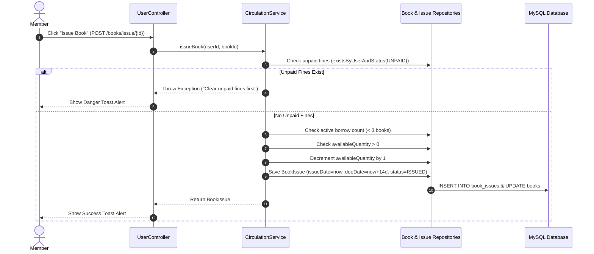
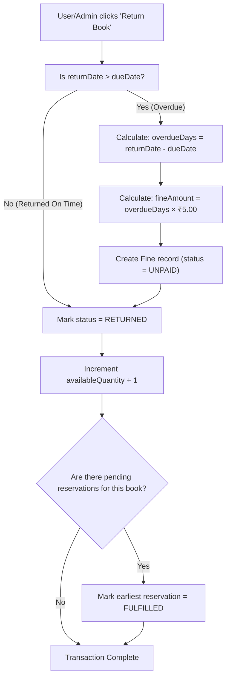

# DLMS — Complete System Architecture & File-by-File Blueprint

This document explains the **system architecture**, **end-to-end transaction processes**, and the **exact purpose of every single file** in the Digital Library Management System (DLMS) codebase.

---

## 1. High-Level Architecture Overview

DLMS is built as an enterprise **Clean Layered Architecture (Modular Monolith)**.

```
       [ Client Browser (HTML5 / Bootstrap 5 / JS) ]
                             │
                             ▼
              [ Spring Security Filter Chain ]
       (CSRF Check, BCrypt Auth, Role-Based Access Control)
                             │
                             ▼
         [ Controller Layer (Web MVC / Presentation) ]
    (Routes HTTP requests, validates forms, returns Views)
                             │
                             ▼
          [ Service Layer (Business Logic Engine) ]
    (Transactional invariants, fine math, inventory checks)
                             │
                             ▼
            [ Repository Layer (Spring Data JPA) ]
       (Derived queries, JPQL custom joins, Hibernate ORM)
                             │
                             ▼
          [ Database Layer (MySQL 8.0 `dlms_db`) ]
```

---

## 2. Core Transaction & Business Processes

### 2.1 The Book Issuing Process


### 2.2 The Book Return & Fine Calculation Process


---

## 3. Complete File-by-File Explanation

### 📦 Root Configuration & Build Files
| File Path | Why It Was Built & Purpose |
|---|---|
| [`pom.xml`](file:///d:/Projects/DLMS/pom.xml) | **Maven Build Descriptor**: Defines all project dependencies: `spring-boot-starter-webmvc`, `spring-boot-starter-data-jpa`, `spring-boot-starter-security`, `spring-boot-starter-thymeleaf`, `spring-boot-starter-validation`, `mysql-connector-j`, `h2`, and `lombok`. Configures the Java 21 compiler and annotation processors. |
| [`README.md`](file:///d:/Projects/DLMS/README.md) | **Developer & Setup Documentation**: Quickstart instructions, default admin/user login credentials, port specifications, database configuration guides, and feature checklist. |

---

### 📦 Application Configuration (`src/main/resources`)
| File Path | Why It Was Built & Purpose |
|---|---|
| [`application.properties`](file:///d:/Projects/DLMS/src/main/resources/application.properties) | **System Properties**: Configures the HTTP server port (`8081`), MySQL HikariCP data source URL (`jdbc:mysql://localhost:3306/dlms_db`), username/password credentials, Hibernate DDL auto (`update`), Thymeleaf cache settings, and library business constants (`loan.duration-days=14`, `fine.daily-rate=5.00`). |

---

### 📦 Java Core: Application & Config (`com.example.DLMS.config`)
| File Path | Why It Was Built & Purpose |
|---|---|
| [`DlmsApplication.java`](file:///d:/Projects/DLMS/src/main/java/com/example/DLMS/DlmsApplication.java) | **Spring Boot Entry Point**: Contains the `public static void main(String[] args)` method with `@SpringBootApplication` to bootstrap the Spring IoC container and embedded Tomcat server. |
| [`SecurityConfig.java`](file:///d:/Projects/DLMS/src/main/java/com/example/DLMS/config/SecurityConfig.java) | **Security Filter Chain**: Implements Spring Security 6 RBAC rules. Configures public routes (`/`, `/catalog`, `/login`, `/register`, `/css/**`), admin routes (`/admin/**`), user-authenticated routes (`/user/**`, `/books/**`), form login with `CustomAuthenticationSuccessHandler`, and BCrypt password encryption. |
| [`DataInitializer.java`](file:///d:/Projects/DLMS/src/main/java/com/example/DLMS/config/DataInitializer.java) | **Database Bootstrapper (`CommandLineRunner`)**: Automatically runs when the application starts. If the database is empty, it seeds the default Admin (`admin@dlms.com` / `admin123`), default member (`user@dlms.com` / `user123`), 4 book categories, and 7 starter books so the application is immediately testable. |

---

### 📦 Domain Entities & Enums (`com.example.DLMS.entity` & `enums`)
| File Path | Why It Was Built & Purpose |
|---|---|
| [`Role.java`](file:///d:/Projects/DLMS/src/main/java/com/example/DLMS/enums/Role.java) | Enum defining system security roles: `ROLE_ADMIN` and `ROLE_USER`. |
| [`IssueStatus.java`](file:///d:/Projects/DLMS/src/main/java/com/example/DLMS/enums/IssueStatus.java) | Enum tracking loan states: `ISSUED` (in possession), `RETURNED` (completed), `OVERDUE` (past due date). |
| [`FineStatus.java`](file:///d:/Projects/DLMS/src/main/java/com/example/DLMS/enums/FineStatus.java) | Enum tracking fine payment states: `UNPAID` and `PAID`. |
| [`ReservationStatus.java`](file:///d:/Projects/DLMS/src/main/java/com/example/DLMS/enums/ReservationStatus.java) | Enum tracking advance bookings: `PENDING`, `FULFILLED`, `CANCELLED`. |
| [`QueryStatus.java`](file:///d:/Projects/DLMS/src/main/java/com/example/DLMS/enums/QueryStatus.java) | Enum tracking support ticket lifecycle: `PENDING` and `RESOLVED`. |
| [`User.java`](file:///d:/Projects/DLMS/src/main/java/com/example/DLMS/entity/User.java) | **Member/Admin Entity**: Maps to the `users` table. Stores name, unique email, hashed password, phone, role, active status, and creation timestamp. |
| [`Category.java`](file:///d:/Projects/DLMS/src/main/java/com/example/DLMS/entity/Category.java) | **Category Entity**: Maps to the `categories` table. Classifies books into departments/genres (e.g. Computer Science, Fiction). |
| [`Book.java`](file:///d:/Projects/DLMS/src/main/java/com/example/DLMS/entity/Book.java) | **Book Entity**: Maps to the `books` table. Stores title, author, unique ISBN, category relationship, total copies, available copies, shelf/rack number, and description. |
| [`BookIssue.java`](file:///d:/Projects/DLMS/src/main/java/com/example/DLMS/entity/BookIssue.java) | **Circulation Loan Entity**: Maps to `book_issues`. Links a `Book` and a `User`, records `issueDate`, `dueDate` (+14 days), `returnDate`, status, and one-to-one fine relation. |
| [`Fine.java`](file:///d:/Projects/DLMS/src/main/java/com/example/DLMS/entity/Fine.java) | **Penalty Entity**: Maps to `fines`. Records overdue days, exact fine amount in ₹, settlement status, and payment timestamp. |
| [`Reservation.java`](file:///d:/Projects/DLMS/src/main/java/com/example/DLMS/entity/Reservation.java) | **Advance Booking Entity**: Maps to `reservations`. Queues readers when a book's stock is 0. Automatically updated upon book return. |
| [`ContactQuery.java`](file:///d:/Projects/DLMS/src/main/java/com/example/DLMS/entity/ContactQuery.java) | **Support Inquiry Entity**: Maps to `contact_queries`. Stores member inquiries, subject, message body, status, and admin resolution response. |

---

### 📦 Data Access Repositories (`com.example.DLMS.repository`)
| File Path | Why It Was Built & Purpose |
|---|---|
| [`UserRepository.java`](file:///d:/Projects/DLMS/src/main/java/com/example/DLMS/repository/UserRepository.java) | **User DAO**: Provides `findByEmail`, `existsByEmail`, and `countByRole` queries. |
| [`CategoryRepository.java`](file:///d:/Projects/DLMS/src/main/java/com/example/DLMS/repository/CategoryRepository.java) | **Category DAO**: Retrieves all categories for catalog dropdowns and filters. |
| [`BookRepository.java`](file:///d:/Projects/DLMS/src/main/java/com/example/DLMS/repository/BookRepository.java) | **Book DAO**: Contains custom JPQL queries for multi-attribute search (`searchAndFilter`) across title, author, ISBN, and category. |
| [`BookIssueRepository.java`](file:///d:/Projects/DLMS/src/main/java/com/example/DLMS/repository/BookIssueRepository.java) | **Circulation DAO**: Tracks active loans, user loan history, overdue loans, and active issue counts. |
| [`FineRepository.java`](file:///d:/Projects/DLMS/src/main/java/com/example/DLMS/repository/FineRepository.java) | **Fine DAO**: Computes aggregates: `sumTotalPaidFines()`, `sumTotalUnpaidFines()`, and checks for outstanding user penalties. |
| [`ReservationRepository.java`](file:///d:/Projects/DLMS/src/main/java/com/example/DLMS/repository/ReservationRepository.java) | **Reservation DAO**: Finds the next user in line for a returned book (`findFirstByBookAndStatusOrderByReservationDateAsc`). |
| [`ContactQueryRepository.java`](file:///d:/Projects/DLMS/src/main/java/com/example/DLMS/repository/ContactQueryRepository.java) | **Inquiry DAO**: Queries support tickets ordered by creation date and pending status. |

---

### 📦 Security & Authentication Layer (`com.example.DLMS.security`)
| File Path | Why It Was Built & Purpose |
|---|---|
| [`CustomUserDetails.java`](file:///d:/Projects/DLMS/src/main/java/com/example/DLMS/security/CustomUserDetails.java) | Bridges our JPA `User` entity to Spring Security's `UserDetails` contract, exposing authorities (`ROLE_ADMIN`, `ROLE_USER`) and account status. |
| [`CustomUserDetailsService.java`](file:///d:/Projects/DLMS/src/main/java/com/example/DLMS/security/CustomUserDetailsService.java) | Implements `UserDetailsService`. Loads users by their email address directly from MySQL. |
| [`CustomAuthenticationSuccessHandler.java`](file:///d:/Projects/DLMS/src/main/java/com/example/DLMS/security/CustomAuthenticationSuccessHandler.java) | Intercepts successful logins: automatically redirects Admins to `/admin/dashboard` and regular Members to `/user/dashboard`. |

---

### 📦 Business Service Engine (`com.example.DLMS.service`)
| File Path | Why It Was Built & Purpose |
|---|---|
| [`UserService.java`](file:///d:/Projects/DLMS/src/main/java/com/example/DLMS/service/UserService.java) | Handles member registration with BCrypt hashing, profile lookups, and account suspension/activation toggles. |
| [`CategoryService.java`](file:///d:/Projects/DLMS/src/main/java/com/example/DLMS/service/CategoryService.java) | Manages category CRUD and catalog classification. |
| [`BookService.java`](file:///d:/Projects/DLMS/src/main/java/com/example/DLMS/service/BookService.java) | Handles adding, editing, and deleting books. Validates ISBN uniqueness and prevents deletion if copies are currently borrowed. |
| [`CirculationService.java`](file:///d:/Projects/DLMS/src/main/java/com/example/DLMS/service/CirculationService.java) | **Core Engine**: Enforces max 3 books limit, checks for unpaid fines, decrements stock on issue, increments stock on return, computes ₹5/day overdue fine, and advances reservation queues. |
| [`FineService.java`](file:///d:/Projects/DLMS/src/main/java/com/example/DLMS/service/FineService.java) | Manages fine records, computes total collected/unpaid revenue, and allows admins to mark fines as `PAID`. |
| [`ReservationService.java`](file:///d:/Projects/DLMS/src/main/java/com/example/DLMS/service/ReservationService.java) | Manages advance booking queues for out-of-stock titles and allows cancellation of pending reservations. |
| [`ContactQueryService.java`](file:///d:/Projects/DLMS/src/main/java/com/example/DLMS/service/ContactQueryService.java) | Persists member inquiries and handles admin resolutions with response notes. |

---

### 📦 Web MVC Controllers (`com.example.DLMS.controller`)
| File Path | Why It Was Built & Purpose |
|---|---|
| [`AuthController.java`](file:///d:/Projects/DLMS/src/main/java/com/example/DLMS/controller/AuthController.java) | Serves the login and registration pages, processes user sign-up with Bean Validation, and handles the 403 Access Denied view. |
| [`HomeController.java`](file:///d:/Projects/DLMS/src/main/java/com/example/DLMS/controller/HomeController.java) | Public portal controller: serves the Home landing page (`/`), book catalog with keyword/category search (`/catalog`), and the contact inquiry form (`/contact`). |
| [`UserController.java`](file:///d:/Projects/DLMS/src/main/java/com/example/DLMS/controller/UserController.java) | Member portal controller: serves `/user/dashboard`, handles book borrowing (`POST /books/issue/{id}`), returning (`POST /books/return/{id}`), advance booking (`POST /reserve/{id}`), and reservation cancellations. |
| [`AdminController.java`](file:///d:/Projects/DLMS/src/main/java/com/example/DLMS/controller/AdminController.java) | Administrative controller: serves the dashboard (`/admin/dashboard`), book management (`/admin/books`), issued loans table (`/admin/issued-books`), member accounts (`/admin/members`), fine clearance (`/admin/fines`), and inquiry inbox (`/admin/queries`). |

---

### 📦 Data Transfer Objects & Exceptions (`com.example.DLMS.dto` & `exception`)
| File Path | Why It Was Built & Purpose |
|---|---|
| [`UserRegistrationDto.java`](file:///d:/Projects/DLMS/src/main/java/com/example/DLMS/dto/UserRegistrationDto.java) | Validated form object capturing `fullName`, `email`, `password` (min 6 chars), and `phone` during registration. |
| [`GlobalExceptionHandler.java`](file:///d:/Projects/DLMS/src/main/java/com/example/DLMS/exception/GlobalExceptionHandler.java) | `@ControllerAdvice` capturing `IllegalArgumentException`, `IllegalStateException`, and unexpected errors. Converts them to user-friendly flash messages or the 500 error page instead of raw stack traces. |

---

### 📦 Frontend Templates & Assets (`src/main/resources/templates` & `static`)
| File Path | Why It Was Built & Purpose |
|---|---|
| [`static/css/style.css`](file:///d:/Projects/DLMS/src/main/resources/static/css/style.css) | Custom styling for elevated cards, status badges (`badge-in-stock`, `badge-out-of-stock`, `badge-overdue`), gradients, and clean responsive typography. |
| [`templates/fragments/layout.html`](file:///d:/Projects/DLMS/src/main/resources/templates/fragments/layout.html) | **Master Layout**: Includes Bootstrap 5.3 & Icons, the responsive role-aware navbar, flash notification toasts, and the footer. |
| [`templates/index.html`](file:///d:/Projects/DLMS/src/main/resources/templates/index.html) | **Homepage**: Hero banner with instant search, repository statistics, and featured book cards. |
| [`templates/catalog.html`](file:///d:/Projects/DLMS/src/main/resources/templates/catalog.html) | **Book Catalog**: Filterable grid of books with stock badges, rack numbers, and "Issue" / "Advance Book" action buttons. |
| [`templates/contact.html`](file:///d:/Projects/DLMS/src/main/resources/templates/contact.html) | **Inquiry Form**: Allows visitors or logged-in members to submit support questions to the library team. |
| [`templates/auth/login.html`](file:///d:/Projects/DLMS/src/main/resources/templates/auth/login.html) | **Sign-In View**: Clean login card with quick-reference demo credentials. |
| [`templates/auth/register.html`](file:///d:/Projects/DLMS/src/main/resources/templates/auth/register.html) | **Registration View**: Member sign-up form with instant field validation error displays. |
| [`templates/user/dashboard.html`](file:///d:/Projects/DLMS/src/main/resources/templates/user/dashboard.html) | **Member Dashboard**: Profile header, active borrowed books with return buttons, reservation queue, fine receipts, and full borrowing history. |
| [`templates/admin/dashboard.html`](file:///d:/Projects/DLMS/src/main/resources/templates/admin/dashboard.html) | **Admin Console**: 8 KPI statistic cards, quick action links, and recent circulation loans table. |
| [`templates/admin/books.html`](file:///d:/Projects/DLMS/src/main/resources/templates/admin/books.html) | **Book Inventory Table**: Manage catalog records, edit book details, and safely delete books. |
| [`templates/admin/book-form.html`](file:///d:/Projects/DLMS/src/main/resources/templates/admin/book-form.html) | **Add/Edit Book Form**: Unified form for adding or updating titles with category dropdown and validation. |
| [`templates/admin/issued-books.html`](file:///d:/Projects/DLMS/src/main/resources/templates/admin/issued-books.html) | **Circulation Monitor**: View all active and returned loans, borrower details, due dates, and return actions. |
| [`templates/admin/members.html`](file:///d:/Projects/DLMS/src/main/resources/templates/admin/members.html) | **Member Directory**: Review all registered users with one-click account suspension/activation. |
| [`templates/admin/fines.html`](file:///d:/Projects/DLMS/src/main/resources/templates/admin/fines.html) | **Fine Settlement**: Overview of unpaid vs settled fines with a "Mark as Paid" action button. |
| [`templates/admin/queries.html`](file:///d:/Projects/DLMS/src/main/resources/templates/admin/queries.html) | **Query Inbox**: View support tickets and resolve them with resolution notes via a modal dialog. |
| [`templates/error/403.html`](file:///d:/Projects/DLMS/src/main/resources/templates/error/403.html) | Friendly Access Denied page when an unauthorized user attempts to view admin pages. |
| [`templates/error/500.html`](file:///d:/Projects/DLMS/src/main/resources/templates/error/500.html) | Friendly System Error page with home recovery button. |

---

### 📦 Test Suite (`src/test/java`)
| File Path | Why It Was Built & Purpose |
|---|---|
| [`CirculationServiceTest.java`](file:///d:/Projects/DLMS/src/test/java/com/example/DLMS/service/CirculationServiceTest.java) | **Unit Test Suite**: Tests the borrow transaction, ensures out-of-stock exceptions are thrown, and verifies the automated ₹5/day overdue fine calculation logic using Mockito. |
| [`DlmsApplicationTests.java`](file:///d:/Projects/DLMS/src/test/java/com/example/DLMS/DlmsApplicationTests.java) | **Spring Boot Context Test**: Verifies that the entire application context and all beans bootstrap cleanly. |

